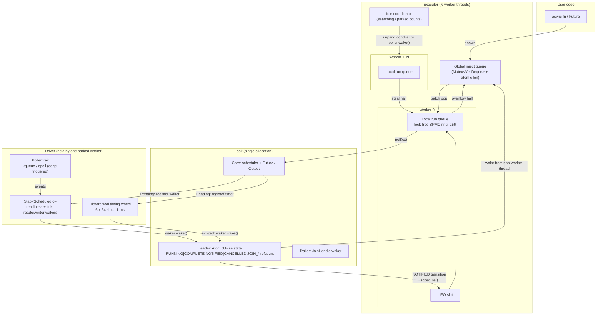

# weft: an async runtime from scratch, and an HTTP/1.1 server on top

[](https://github.com/TejasBaid/rust-async-runtime/actions/workflows/ci.yml)

**weft** is a multi-threaded, work-stealing async runtime for Rust, written from
scratch (no mio, tokio, async-std or smol) directly on the OS readiness APIs:
`kqueue` on macOS/BSD and `epoll` on Linux, called through raw `libc`
syscalls. Tasks live in a single heap allocation with a lock-free state machine
and a hand-written `Waker` vtable. They are scheduled on per-worker lock-free
run queues that support stealing half of a queue at once, plus a global
injector and a LIFO slot. Timers use a hierarchical timing wheel. On top of it,
**weft-http** is an HTTP/1.1 server with an incremental parser, keep-alive,
pipelining and chunked streaming. The concurrency core is model-checked with
[loom](https://github.com/tokio-rs/loom), and the runtime is benchmarked
against Tokio using the same workloads and the same number of threads.

```rust
let rt = weft::Runtime::new()?;
rt.block_on(async {
    let listener = weft::net::TcpListener::bind("127.0.0.1:0")?;
    let (tx, rx) = weft::sync::oneshot::channel();
    weft::spawn(async move {
        weft::time::sleep(Duration::from_millis(5)).await;
        tx.send("hello").unwrap();
    });
    assert_eq!(rx.await.unwrap(), "hello");
    Ok::<_, std::io::Error>(())
})?;
```

## Features

**Runtime (`crates/weft`)**
- **Reactor**: one `Poller` trait with two backends, kqueue (`EVFILT_READ`/`WRITE`
  with `EV_CLEAR`, wake-ups through `EVFILT_USER`) and epoll (`EPOLLET`, wake-ups
  through `eventfd`). Both are edge-triggered, and each descriptor is
  registered exactly once.
- **Executor**: N worker threads. Each has a bounded lock-free SPMC ring
  buffer (256 slots) with steal-half. There is also a global inject queue, a
  LIFO slot for message-passing locality, randomized victim selection, a
  throttled "searching" state so idle workers don't all wake at once, and
  parking either in the OS poller or on a condvar.
- **Tasks**: each task is one allocation (header, future/output and join
  waker). A packed atomic state word holds the lifecycle flags and the
  refcount. The `RawWakerVTable` is custom. Tasks get `JoinHandle<T>` with
  output, `abort()`, panic capture (`JoinError::is_panic`), `yield_now`, and
  `spawn_blocking` (a separate, elastic thread pool built on the same task
  type).
- **Timers**: a hierarchical timing wheel (6 levels × 64 slots, 1 ms ticks,
  about 2.2 years of range). Insert and cancel are O(1), and finding the next
  deadline uses bitmap scans. Provides `sleep`, `sleep_until`, `timeout` and
  `Sleep::reset`.
- **I/O**: `TcpListener` and `TcpStream` (non-blocking `connect(2)` through
  raw syscalls), the `AsyncRead`/`AsyncWrite` traits and their `Ext` helpers,
  `into_split`, and concurrent read/write through `&TcpStream`.
- **Channels**: a lock-free `oneshot`, bounded `mpsc` with FIFO back-pressure,
  unbounded `mpsc`, and an `AtomicWaker`.
- **Clean shutdown**: dropping the `Runtime` joins the workers and cancels
  every live task, so futures are dropped and the reference cycles through
  wakers are broken. Resources still registered are then woken with an error.

**HTTP server (`crates/weft-http`)**
- An **incremental parser** that never rescans bytes and resumes mid-head or
  mid-chunk. It handles chunked request bodies (with extensions and
  trailers) and enforces limits on head size, header count and body size (431
  and 413). It rejects request-smuggling patterns (`Content-Length` together
  with `Transfer-Encoding`, or conflicting `Content-Length` values) and
  obsolete line folding.
- **Keep-alive** with an idle timeout and a request timeout (408). The timer is
  re-armed lazily so it stays off the hot path.
- **Pipelining-safe**: requests are handled strictly in order. Responses to
  every request already buffered are batched into one `write`.
- **Chunked streaming responses** (`Body::channel`), which fall back to
  buffering for HTTP/1.0 clients. `HEAD`, 204 and 304 responses are framed
  correctly.
- A `Router` with `:param` and `*wildcard` segments (405 with `Allow`), and
  `StaticFiles` with percent-decoding, `..` rejection and a canonical-path
  check. File reads go through `spawn_blocking`.
- An example server (`examples/server.rs`) serving JSON, path parameters,
  echo, a chunked NDJSON stream, runtime stats and static files.

## Architecture



**The life of a wake-up.** A task polls `TcpStream::read` and gets
`EWOULDBLOCK`. It clears the readiness it observed, stores its waker in the
socket's `ScheduledIo` and returns `Pending`. The worker sets the task's state
back to idle. Later, the worker that is parked in `kevent`/`epoll_wait`
receives the edge. It sets the readiness bits (bumping a tick so that a stale
clear cannot erase this edge), takes the waker and calls `wake()`. That
performs the `NOTIFIED` transition, which guarantees the task is queued at
most once. Because the core of the worker that drove the reactor is installed
in its thread-local context, the task goes into that worker's LIFO slot and
runs next, while its data is still in cache.

### Source map

| Path | What |
|---|---|
| `weft/src/sys/{mod,kqueue,epoll}.rs` | `Poller` trait + raw-syscall backends |
| `weft/src/driver/{mod,io}.rs` | reactor turn, readiness/tick protocol, registrations |
| `weft/src/time/{mod,wheel}.rs` | timing wheel, `Sleep`, `timeout` |
| `weft/src/task/state.rs` | lock-free task state machine |
| `weft/src/task/{core,raw,harness,waker,join}.rs` | task layout, vtable, poll/complete/cancel, `Waker` vtable, `JoinHandle` |
| `weft/src/runtime/scheduler/queue.rs` | lock-free steal-half run queue |
| `weft/src/runtime/scheduler/{worker,idle,park,inject}.rs` | worker loop, wake throttling, parking, global queue |
| `weft/src/sync/{oneshot,mpsc,atomic_waker}.rs` | channels |
| `weft/src/loom_tests.rs` | loom models |
| `weft-http/src/parser.rs` | incremental HTTP/1.1 parser |
| `weft-http/src/server.rs` | connection loop: keep-alive, pipelining, timeouts, chunked |

## Design decisions and tradeoffs

- **Own run queue instead of `crossbeam-deque`.** crossbeam's Chase-Lev deque
  is unbounded and grows by reallocating, which needs epoch-based reclamation.
  A scheduler does not need an unbounded local queue. When the ring is full,
  half of it moves to the global queue in one CAS. A fixed array means no
  reclamation, a single allocation, and an algorithm small enough for loom to
  check (`(steal, real)` packed head cursors and a two-phase steal, the same
  design as Go's and Tokio's). Stealing *half* amortizes the cost of stealing.
- **One allocation per task, with a packed state word.** Wakers, `JoinHandle`
  and queue entries are thin pointers to the header, and each one carries a
  reference. All transitions are CAS loops on one word, so a task cannot be
  queued twice (`NOTIFIED`) or polled concurrently (`RUNNING`), and its output
  is handed over exactly once (`COMPLETE` + `JOIN_INTEREST`/`JOIN_WAKER`). The
  cost is unsafe code (every block has a `SAFETY:` comment, enforced by
  `clippy::undocumented_unsafe_blocks`) and the need for loom.
- **The LIFO slot.** When a task wakes another task on the same worker, the
  woken task runs next. This is a large win for request/response patterns
  (see the ablation below). To keep two tasks that ping each other from
  starving the rest of the queue, the slot is capped at 3 consecutive polls,
  and tasks that wake themselves (`yield_now`) skip it.
- **Workers drive the reactor; there is no reactor thread.** An idle worker
  that wins a `try_lock` on the driver blocks in the poller, with a timeout
  set by the timing wheel. The other idle workers wait on condvars. Busy
  workers poll the driver without blocking every 61 ticks so I/O and timers
  keep making progress under load. This saves a thread hop per I/O event. The
  cost is that a task which blocks a worker can delay I/O for tasks that
  would have run on it.
- **Wake-up throttling.** At most one sleeper is woken per notification, and
  only when no worker is already searching. The last searcher to give up
  re-checks every queue, and `SeqCst` fences close the Dekker-style race.
  This avoids thundering herds, which matters because a wake-up costs a
  syscall.
- **Edge-triggered I/O with a readiness tick.** A descriptor is registered
  once, and the event loop never re-arms it. A task clears readiness only if
  no newer event has arrived (the tick check), which closes the classic
  "edge lost between `EWOULDBLOCK` and clear" race.
- **Timing wheel rather than a heap.** Insert and cancel are O(1), and most
  server timers (idle timeouts) are cancelled rather than fired. The cost is
  1 ms resolution, though deadlines round *up*, so timers never fire early.
- **`mpsc` uses a mutex. `oneshot` and `AtomicWaker` are lock-free.** The
  bounded channel's back-pressure (a FIFO of blocked senders that forwards
  wake-ups from cancelled senders) is much easier to get right under a lock.
  Critical sections are a few instructions, and wakers are always invoked
  and dropped outside the lock. The benchmarks show this is not a bottleneck
  at these scales.
- **One timer per HTTP connection, re-armed lazily.** The connection keeps a
  single `Sleep`. On each read the deadline moves, but the wheel is only
  touched when the timer fires early. This keeps the wheel's mutex off the
  request path.

## Build, run, test

Requires stable Rust 1.85 or newer (edition 2024).

```bash
cargo build --workspace --release
cargo test --workspace                       # unit, integration, stress, HTTP end-to-end
cargo clippy --workspace --all-targets -- -D warnings
cargo fmt --all --check

# loom model checking of the lock-free core (task state machine, run queue,
# AtomicWaker, oneshot). The preemption bound keeps the 3-thread queue model
# tractable; the 2-thread models also pass unbounded.
RUSTFLAGS="--cfg loom" LOOM_MAX_PREEMPTIONS=3 cargo test -p weft --lib --release loom_

# example server
cargo run --release -p weft-http --example server -- 127.0.0.1:8080
curl localhost:8080/json; curl -N localhost:8080/stream; open http://localhost:8080/

# benchmarks
cargo bench -p weft-bench --bench runtime    # runtime micro-benchmarks vs Tokio
scripts/bench_http.sh 4 64 10                # HTTP: weft vs Tokio baseline (oha + loadgen)
```

Every network test binds to port 0. CI (`.github/workflows/ci.yml`) runs
build, test and clippy on `ubuntu-latest` (epoll) and `macos-latest` (kqueue),
plus `fmt`, the loom suite and `cargo doc` with warnings denied.

### Test inventory

| Suite | Count | Covers |
|---|---|---|
| `weft` unit (`--lib`) | 60 | poller backends, slab, timing wheel (incl. a randomized model check against a reference), task state machine, task refcounts and waker semantics with a mock scheduler, run queue (incl. a multi-threaded steal stress test), idle coordinator, readiness tick protocol, driver resource accounting |
| `weft/tests/runtime.rs` | 23 | spawn/join, panics, abort, detach, output drop counts, cross-thread wakes, `yield_now` fairness, `spawn_blocking`, shutdown cancellation |
| `weft/tests/time.rs` | 11 | accuracy, ordering, `timeout`, `reset`, cancellation, 20k concurrent timers, timers firing while all workers are busy |
| `weft/tests/tcp.rs` | 8 | echo, 8 MiB transfer, 200 concurrent clients, refused connect, peer close, shared read/write |
| `weft/tests/sync.rs` | 13 | oneshot and mpsc semantics, back-pressure, forwarding of cancelled-sender wake-ups |
| `weft/tests/stress.rs` | 5 | 100k-task spawn storm, 64-task token ring, wakes from 8 OS threads, bursty external spawns, runtime churn |
| loom (`--cfg loom`) | 10 | queue steal/pop/overflow races, two concurrent stealers, AtomicWaker lost-wakeup, oneshot send/drop races, task join-vs-complete, remote wake while running, abort-vs-run |
| `weft` doc tests | 8 | runnable examples in the API docs |
| `weft-http` unit + doc | 21 | parser (byte-at-a-time, every split point, pipelining, malformed input, limits), router, date, sanitizer |
| `weft-http/tests/server.rs` | 22 | keep-alive, pipelining order, split writes, close semantics, chunked in/out, HEAD/204, 400/405/408/413/431, static files and traversal, 32 concurrent clients, graceful stop |

## Benchmarks

All numbers below were measured on an otherwise idle Apple M4 (10 cores,
16 GB) running macOS 26.4, with Rust 1.99, Tokio 1.53.3, criterion 0.5.1 and
oha 1.16.0. The only other workload was an idle background VM. A sampler
recorded the 1-minute load average every 15 s:

- **Before the runs:** 1.9.
- **During the criterion runs:** 1.9–3.5.
- **During the HTTP runs:** 4–12. This load came from the benchmark itself:
  64 load-generator threads, oha and two 4-worker servers, all on the same
  10 cores. Load fell straight back once the runs ended.

To reproduce, run `cargo bench -p weft-bench --bench runtime` and
`scripts/bench_http.sh 4 64 10`.

### Runtime micro-benchmarks vs Tokio (4 worker threads each)

The table shows criterion's median time per iteration from two complete runs
(lower is better). The criterion confidence intervals were within ±1–3%.

| Benchmark (work per iteration) | weft run 1 | Tokio run 1 | weft run 2 | Tokio run 2 | weft vs Tokio |
|---|---:|---:|---:|---:|---:|
| `spawn_many`: spawn and join 10,000 tasks from a task | 1.46 ms | 1.96 ms | 1.38 ms | 1.93 ms | ~1.4× faster |
| `chained_spawn`: 1,000 tasks, each spawning the next | 99.2 µs | 119.8 µs | 108.9 µs | 130.1 µs | ~1.2× faster |
| `yield_many`: 200 tasks × 200 `yield_now` | 0.53 ms | 1.10 ms | 0.51 ms | 0.80 ms | 1.6–2.1× faster |
| `mpsc_ping_pong`: 10,000 round trips over capacity-1 channels | 1.06 ms | 1.51 ms | 1.07 ms | 1.67 ms | ~1.5× faster |
| `mpsc_contended`: 8 producers × 2,000 messages, capacity 128 | 1.09 ms | 1.97 ms | 1.09 ms | 2.03 ms | ~1.8× faster |
| `oneshot_spawn_round_trip`: 1,000 × (spawn, send, await) | 168.5 µs | 193.7 µs | 168.8 µs | 219.8 µs | 1.15–1.3× faster |

**LIFO-slot ablation** (weft, the same ping-pong workload). With the LIFO
slot: 1.03 ms (run 1) and 1.06 ms (run 2). Without it: 1.86 ms and 1.92 ms.
The slot is worth about **1.8×** on message passing.

**Reading the results.** On this machine and at this scale, weft is faster
than Tokio on every micro-benchmark, by 1.15× to 2×, and both runs agree.
The ablation shows that much of the message-passing advantage comes from
the LIFO slot. The rest of the gap is plausibly simply less work per
operation: weft has no coop budgeting, tracing hooks or metrics, and its
channel uses tiny mutex critical sections. I have not profiled this, so it
is a hypothesis. These are micro-benchmarks of scheduler overhead on one
machine, not a claim that weft is a faster runtime in general. Tokio's extra
machinery (coop budgeting in particular) buys fairness and robustness that
weft lacks; see the limitations below.

### HTTP/1.1 throughput and latency

This compares two servers, each with 4 worker threads, on loopback with 64
keep-alive connections over 10 s. One is the `weft-http` example server. The
other, `weft-bench/examples/tokio_http.rs`, uses the **same parser, router and
response encoder driven by Tokio**, so the comparison isolates the runtime.
The Tokio baseline does slightly less work, because it has no keep-alive or
request timers. I ran three rounds, interleaved. Each row shows the median
round's throughput and that same round's latency. Every run had a 100%
success rate and zero errors.

| Load | Server | Requests/s (median of 3) | All 3 rounds | p50 | p99 |
|---|---|---:|---|---:|---:|
| oha, `GET /plaintext` | weft | **209,928** | 211.6k / 209.9k / 209.9k | 0.30 ms | 0.48 ms |
| | Tokio baseline | **210,819** | 218.2k / 210.8k / 209.9k | 0.30 ms | 0.46 ms |
| oha, `GET /json` | weft | **211,477** | 211.5k / 210.3k / 211.6k | 0.30 ms | 0.50 ms |
| | Tokio baseline | **210,410** | 211.7k / 210.4k / 210.3k | 0.30 ms | 0.46 ms |
| loadgen, `/plaintext`, no pipelining | weft | **220,645** | 220.8k / 220.6k / 219.7k | 0.29 ms | 0.45 ms |
| | Tokio baseline | **223,092** | 224.0k / 222.4k / 223.1k | 0.29 ms | 0.44 ms |
| loadgen, `/plaintext`, pipeline depth 16 | weft | **3,189,670** | 3.19M / 3.19M / 3.16M | 0.31 ms\*\* | 0.60 ms\*\* |
| | Tokio baseline | **3,227,266** | 3.23M / 3.25M / 3.23M | 0.31 ms\*\* | 0.59 ms\*\* |

\*\* Latency of a batch of 16 pipelined requests.

**Reading the results.** On HTTP the two runtimes are **effectively tied**.
- **oha:** both servers settle at about 210k req/s with identical latency.
  The ceiling is the same for both, which suggests the oha client is the
  bottleneck.
- **loadgen:** Tokio is **about 1% faster**, both with and without
  pipelining. This held in every round, so it is a small but real
  difference, not noise.
- **Tail latency:** p99.9 stays under 0.8 ms and the maximum under 3.3 ms
  for both servers.
- **Pipelining:** throughput reaches about 3.2M requests/s, because
  responses to all buffered requests go out in a single `write`.
- **Takeaway:** for a server spending real time in syscalls, scheduler
  overhead stops being the bottleneck. weft's micro-benchmark lead does not
  carry over.

A few optimizations came out of analyzing slow early runs. I found them by
reading the code, not with a profiler:
- **Re-arming the connection timer lazily.** Registering a timer on every
  read put the wheel's mutex on the request path.
- **Skipping the wheel lock** when a `Sleep` is re-polled by the same task.
- **Removing a global atomic request counter** from the example server, which
  had become a contended cache line.

## Limitations and future work

- **No cooperative budgeting.** A task whose sockets are always ready can keep
  running for a long time before it yields. Tokio's coop budget forces
  periodic yields. The LIFO cap and the global-queue interval soften this but
  do not replace it.
- **Blocking a worker stalls the reactor and timers it was driving.** Use
  `spawn_blocking`. There is no `block_in_place`.
- **The LIFO slot is not stealable**, so a task sitting in it waits if its
  worker blocks.
- **Timer wheel is a single mutex**; Tokio shards timers per worker.
  Connection timeouts avoid it on the hot path, but a timer-heavy workload
  across many cores would contend.
- **`mpsc` is mutex-based** (see tradeoffs). A lock-free block-linked list
  would scale better with very many producers.
- **I/O surface**: TCP only (no UDP, Unix sockets, signals or process
  spawning). Name resolution in `TcpStream::connect` is blocking (pass a
  `SocketAddr`). There is no io_uring backend.
- **HTTP**: HTTP/1.x only (no TLS, HTTP/2 or `Expect: 100-continue`). Bodies
  are fully buffered on the request side. Static files are read whole into
  memory, without range requests, ETags or `sendfile`.
- **Loom coverage** is limited to the lock-free core. The idle/parking
  protocol is covered by stress tests rather than a model.
- **Future work**: per-worker timer wheels, a coop budget, `block_in_place`,
  an io_uring backend, a lock-free `mpsc`, `select!`/`join!` macros, and
  `#[weft::main]`.

## License

MIT, see [LICENSE](LICENSE).
